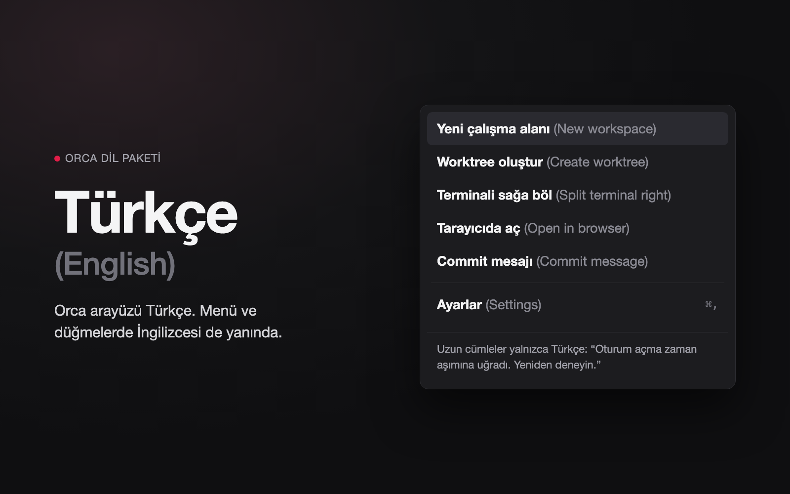
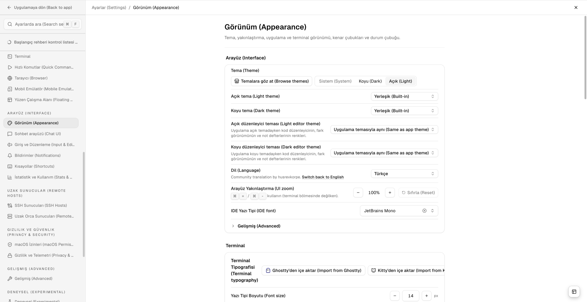

# Türkçe (English) — Orca dil paketi





Orca arayüzünü Türkçeye çevirir. Kısa etiketler (menüler, düğmeler) orijinal İngilizcesini parantez içinde de gösterir: **Ayarlar (Settings)**, **Yeniden dene (Retry)**. Böylece İngilizce dokümanlar ve videolarla eşleştirmek kolay olur. Uzun cümleler yalnızca Türkçedir.

Turkish translation of the Orca interface. Short labels keep the original English in parentheses.

## Kurulum

Orca → Ayarlar → Eklentiler → **Türkçe (English)** → Yükle. Sonra Ayarlar → Dil → **Türkçe (English)**.

Ya da terminalden:

```sh
orca plugin install HusrevKorpe/orca-turkce
```

Güncellemeler Orca'nın otomatik eklenti güncellemesiyle gelir.

## Geliştirme

`source/tr.json` her metnin İngilizcesini ve Türkçesini tutar; `locales/tr.json` ondan üretilir:

```sh
python3 build.py
orca plugin validate .
```

Yeni sürüm: `orca-plugin.json` içindeki `version`'ı artırın, commit'leyin ve `vX.Y.Z` etiketini push'layın.
